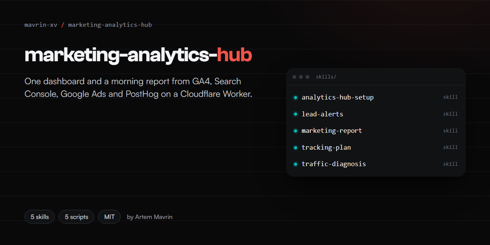

# marketing-analytics-hub

**One dashboard and a morning report for a small team's site and ads: GA4, Search Console, Google Ads and PostHog in one Cloudflare Worker, with new-lead alerts to sales.**

Four tabs, four different numbers, and a monthly "why did leads drop" meeting where nobody trusts any of them. This pack puts them in one place, says which tool answers which question, and flags broken tracking before anyone reads a trend into it.

   

```bash
git clone https://github.com/mavrin-xv/marketing-analytics-hub && cd marketing-analytics-hub
./install.sh --hub ~/my-hub          # skills into ~/.claude/skills + a copy of the worker
```

<!-- install-notes:start -->
Other ways in: as a Claude Code plugin, run `/plugin marketplace add mavrin-xv/marketing-analytics-hub` and then `/plugin install marketing-analytics-hub@marketing-analytics-hub`. For Codex or another agent that reads `SKILL.md`, copy the folders under `skills/` into its skills directory. On Windows, run `install.sh` from Git Bash or WSL and type `py -3` where these docs say `python3`.
<!-- install-notes:end -->

## What it solves

| Pain | What the pack does |
|---|---|
| GA4, Search Console, Ads and PostHog each tell a different story | One D1 database, one dashboard, one rule: GA4 for how many, PostHog for why, Search Console for search, Ads for cost |
| The report arrives with numbers from a sync that failed two days ago | Every pull is logged as ok, partial or error; the report prints sync problems first and alerts after two failures |
| "+300% this week!" because last week was half empty | Week-over-week changes are dropped when the previous week is not fully stored |
| A web form fires the lead event, but sales never gets the lead | `/hook/lead` stores every lead, then posts it to Slack or Telegram, and re-sends undelivered ones; the report compares lead events with leads received |
| Staging, bots and your own team inflate the numbers | Host filters, staging referrer flags, internal email domain filter, sessions-per-user check |
| "The new page doubled conversions" on 17 people | `compare.py` gives the p-value, the range and the people you still need |
| Half the traffic is "Unassigned" | `utm.py` builds and lints links and event names before a campaign goes out |

## What's inside

| Skill | What it does | Say |
|---|---|---|
| [analytics-hub-setup](skills/analytics-hub-setup/SKILL.md) | Deploys the worker, connects each source, backfills history, proves every source synced | "set up the analytics hub", "connect GA4" |
| [marketing-report](skills/marketing-report/SKILL.md) | Daily or weekly report: how many, why, search, ads, leads, then the reasons not to trust a number | "morning report", "how did the site do" |
| [traffic-diagnosis](skills/traffic-diagnosis/SKILL.md) | Measurement first, then hypotheses, breakdowns, a verdict with confidence; honest small-sample reads | "why did traffic drop", "is this test significant" |
| [tracking-plan](skills/tracking-plan/SKILL.md) | Event names, lead events, UTM rules, Ads conversion audit, QA on the live site | "tracking plan", "Unassigned traffic", "UTM" |
| [lead-alerts](skills/lead-alerts/SKILL.md) | Wires forms, CRMs or PostHog to the sales channel, tests every form, reconciles counts | "notify sales on new leads", "we are missing leads" |

Worker template in `templates/worker/`: `src/` (sources, sync, report, leads, API), `schema.sql`, `wrangler.toml.example`, a static dashboard in `public/`, and an offline test (`npm test`).

Scripts (Python standard library, each with `--help`): `check_config.py`, `digest.py`, `compare.py`, `utm.py`, `send_test_lead.py`.

## Quick start

1. Copy the worker and deploy it (the full walkthrough is in the setup skill):
   ```bash
   ./install.sh --hub ~/my-hub && cd ~/my-hub
   npx wrangler d1 create marketing-hub     # paste the id into wrangler.toml
   npm run db:init && npm test && npx wrangler deploy
   ```
2. In Claude Code:
   ```
   > set up the analytics hub for acme-coffee.com with GA4, Search Console and PostHog, report to Telegram
   ```
3. Next morning at 08:00 UTC the report arrives. Or ask for it:
   ```
   > morning report
   ```

Try it offline on the invented coffee roaster first:

```bash
python3 skills/marketing-report/scripts/digest.py examples/acme-coffee/snapshot.json
```

Sample output (full file: `examples/acme-coffee/morning-report.txt`):

```
HOW MANY (GA4)
Sessions 7d: 2,874 (+6% wow)
Channels: Organic Search 1,240, Direct 702, Paid Search 455, Unassigned 214

WHY (PostHog)
form_submitted people 7d: 17 (+21% wow)
Leads start on: /wholesale (11), /subscriptions (4), /contact (2)

LEADS: 2 yesterday, 6 in 7 days (webhook, tests excluded)

CHECK BEFORE YOU TRUST
[high] PostHog saw 17 people fire form_submitted, the lead webhook received 6.
       Leads may be getting lost between the form and sales.
[medium] Referrer 'acme-coffee.webflow.io' looks like staging or a preview build.
```

## How it works

```
 06:00 posthog ─┐
 06:30 ga4     ─┤  pull a short window, write only changed rows
 07:00 gsc     ─┼────────────────────────────────────────────► D1
 07:30 ads     ─┘  log ok / partial / error per run             │
                                                                ▼
 08:00 report ──► snapshot ──► text report ──► Telegram / Slack
                                                                ▲
 browser ──► dashboard ──► /api/* (reads D1 only) ──────────────┘

 site form / CRM / PostHog ──► /hook/lead ──► store ──► sales channel
                                               └─ re-sent at 08:00 if delivery failed
```

One source per cron slot keeps every run under the free plan's 50-subrequest cap, and one broken source never blocks the rest. The dashboard reads only D1, so it stays up when a vendor API is down. Details: [docs/architecture.md](docs/architecture.md), tables and API: [docs/data-model.md](docs/data-model.md).

## Configure

| What | Where |
|---|---|
| Sites, source ids, report channels, lead events | `[vars]` in `wrangler.toml` (from `templates/worker/wrangler.toml.example`) |
| Keys and tokens | `npx wrangler secret put NAME`, list in `skills/analytics-hub-setup/references/sources-setup.md` |
| Check before deploy | `python3 skills/analytics-hub-setup/scripts/check_config.py --toml wrangler.toml --secrets .dev.vars` |
| Goals, lead definition, tracking quirks | `templates/analytics-profile.md` (copy and fill) |
| Flag thresholds | `flags()` in `skills/marketing-report/scripts/digest.py`, reasons in `skills/marketing-report/references/anomaly-checks.md` |
| Cron times | `wrangler.toml` and `SLOTS` in `templates/worker/src/index.js`, changed together |

## Honest limits

- The worker is tested offline only: `npm test` runs it against an in-memory D1 and mocked Google, PostHog, Telegram and Slack APIs. It has not been deployed and run against live accounts by the authors, and `wrangler deploy` was not run as part of this release.
- The dashboard HTML was not checked in a browser at release time.
- Users summed over 7 days are person-days, not unique people. The report labels them; use PostHog insights for exact uniques.
- Google Ads access needs an approved developer token. Test-level tokens only read test accounts.
- Search Console breakdowns ask for 5,000 rows per request. Bigger sites lose the long tail until they raise the limit or add paging.
- Free-plan limits (50 subrequests, 5 cron triggers per account, D1 write and read caps) change over time; check `skills/analytics-hub-setup/references/free-tier-limits.md` against Cloudflare's pages.
- No Meta Ads, Bing or LinkedIn source yet. The long-format tables make adding one a new file, not a migration.

## Credits

- Analytics profile interview and the "measurement breakage first" order: inspired by https://github.com/clamp-sh/analytics-skills (MIT).
- Event naming (object_action) and UTM conventions: inspired by the analytics-tracking skill in https://github.com/coreyhaines31/marketingskills (MIT).
- Propose-then-confirm for any change to an ad account: inspired by the Google Ads MCP server at https://github.com/googleads/google-ads-mcp (Apache-2.0).
- Small-sample reading of conversion changes: inspired by https://github.com/boringmarketer/boring-marketing-skills (MIT).
- API behaviour from the official docs: Google Analytics Data API, Search Console API, Google Ads API, PostHog query API, Cloudflare Workers and D1.
- Repo and skill layout: modelled on https://github.com/anthropics/skills and https://github.com/obra/superpowers (MIT).

Ideas only from all of the above; no code was copied.

## Contributing

See [CONTRIBUTING.md](CONTRIBUTING.md). Agents working on the repo: [AGENTS.md](AGENTS.md).

<!-- author:start -->
## Author

Built and maintained by [Artem Mavrin](https://github.com/mavrin-xv). This repo is one of a set of agent skill packs for marketing and operations work. Each one installs on its own; the full list is in [agent-skill-packs](https://github.com/mavrin-xv/agent-skill-packs). If a pack saved you an afternoon, a star helps other people find it.
<!-- author:end -->

## License

MIT. See [LICENSE](LICENSE).
